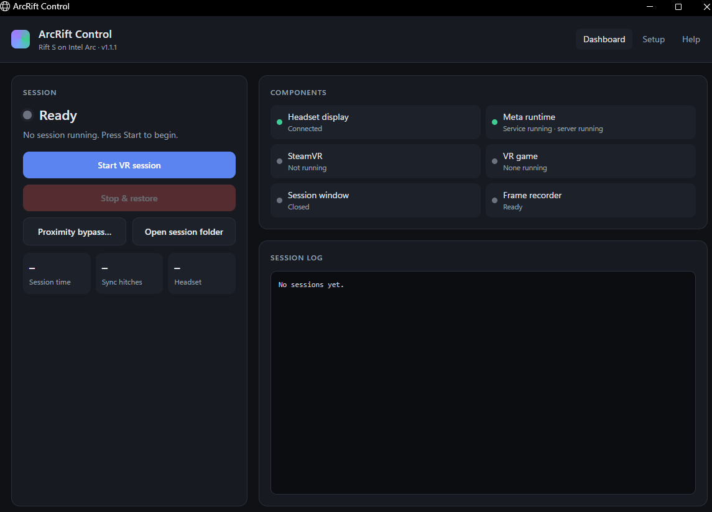

# ArcRift 1.1.2: Oculus Rift S on Intel Arc

by **funrun** · free and open source (MIT)

ArcRift runs an **Oculus Rift S** on an **Intel Arc** graphics card, a combination Meta does not support,
so you can play **SteamVR games** (tested with VRChat). It is a community workaround. It is not made or supported
by Meta, Oculus, Intel or Valve.

> **Experimental, use at your own risk.** While a session runs, ArcRift temporarily changes Windows display
> settings, Meta runtime settings and the Rift S display mode, and restores them afterwards. An early
> development version once caused desktop and headset image corruption. Read the safety rules below.

## What you need

- Windows 11
- An **Intel Arc** graphics card with the headset's DisplayPort connected to it.
  **Tested: Arc A770** (Intel driver 32.0.101.9150). Other Intel Arc cards (A750, A580, B580, B570 …) are
  allowed but **untested**; please report how it goes.
- Oculus Rift S, plugged in (USB + DisplayPort)
- The **Meta Horizon** (Oculus) PC app and **SteamVR** (any Steam library folder works), with **Steam running and signed in**
  when you start a session
- Microsoft Edge (comes with Windows 11; used to show the app window)

## Join the discord for questions or suggestions 
https://discord.gg/aXRV5XjZM
## First-time setup

1. Keep this whole folder together, somewhere like `Documents\ArcRift`.
2. If the folder has no `arc_rift_bridge.dll` / `release-manifest.json` (for example a source-only download),
   run **BUILD-RELEASE.cmd** once. It needs the free *Visual Studio 2022 C++ Build Tools*.
3. Open **ArcRift Control.exe** → **Setup**. With the Meta Horizon app open and the headset light on,
   follow the 3 steps (plugged in → unplugged → plugged back in) and press **Save**.
   Setup records which display is your headset and which GPU you have. Start stays disabled until this is done.

## Playing

1. **Dashboard → Start VR session**, then approve the administrator prompt. A PowerShell window opens.
   **Leave it open**: it restores everything at the end. SteamVR starts automatically.
   If the headset has gone to sleep (it sat unused), the session says so and waits: put it on, or pick it up and
   move it, and it continues 10 s after the headset wakes.
2. When the status says **Running**, start your SteamVR game (for example from Steam in VR mode).
3. Optional: press **Proximity bypass…** and set *Bypass Proximity Sensor Check* to **On** (do this after Running;
   close the Debug Tool before stopping).
4. When you're done: quit the game, then press **Stop & restore** and wait until the session shows as restored.

## Safety rules

- **Never close the administrator PowerShell window** during a session.
- **Never run two copies of ArcRift at the same time.**
- If that window closed or crashed before cleanup finished, the app shows **Needs recovery**: plug in the
  headset, close your game and SteamVR, and press **Recover**. (If it shows **Restoring…**, automatic recovery is
  already running: just wait.)
- If Recover finished but **Needs recovery** stays (usually because your monitor setup changed during the session),
  press **Clear…**. It changes nothing; it re-checks that the Meta settings, headset display mode and plugins are
  restored, then clears the warning. Check Windows display settings afterwards.
- If you see lag, smearing or garbled pixels, take the headset off and press **Stop & restore** right away.

## What a session does by itself

- Stops and restores everything on real trouble: the headset frame rate dropping below 45 fps twice in a row,
  no frames for 3 s, the GPU device being lost or hung, sustained SteamVR sync errors (more than 20 in 30 s, nonstop for 2 minutes),
  Meta or SteamVR exiting, a Windows display-driver reset, or low disk space.
- Pauses the freeze check while the headset is off, and resumes it when you put it back on.
- If Meta's runtime stops responding for 30 s, restores everything automatically.
- Records frame timings with PresentMon (`presentmon.csv` in each session folder). Delete `PresentMon.exe`
  to turn this off.

## Known issues

- **First start after the headset sat unused:** Meta looks for the headset display only once, when its runtime
  starts, and a sleeping headset has none. Since 1.1.2 the session waits for the headset to wake first, and if Meta
  still misses the display it wakes the headset with Meta's normal runtime and retries once.

- **Putting the headset down for a while:** after about 20 s without movement, Meta pauses tracking, and picking
  the headset up again can freeze Meta's runtime. ArcRift notices and restores; just start a new session.
- **Busy VRChat worlds** are mostly limited by the CPU: lower *Maximum Shown Avatars*, hide *Very Poor* avatars,
  and enable the particle limiter.
- **No ASW:** Meta's frame smoothing (ASW) does not run on Intel Arc.
- The upstream project this builds on warns that Meta's runtime can, rarely, need a PC restart.

## Folder contents

| Item | Purpose |
|---|---|
| `ArcRift Control.exe` | The app: status, start/stop, recovery, setup |
| `START MANUAL SESSION.cmd`, `STOP AND RESTORE.cmd`, `RECOVER.cmd` | The same actions without the app |
| `test-ovr-d3d11.ps1` and the other `.ps1` files | The session script that sets up, guards and restores |
| `arc_rift_bridge.dll`, `native_source_*.exe`, `display_probe.exe`, `bridge_selftest.exe` | Bridge and helpers (built by `BUILD-RELEASE.cmd`) |
| `release-manifest.json` | SHA-256 of each program; a session refuses to start if any differs |
| `rift-s-native-test.edid` | The Rift S display mode applied during a session |
| `arcrift-config.json`, `arcrift-identity.txt` | Written by Setup / the session: your headset and GPU |
| `source\`, `app-source\` | Full source code |
| `d3d11-…` folders | One per session: logs, frame timings, cleanup results |

## Privacy

Session folders (`d3d11-…`), `arcrift-config.json` and `arcrift-identity.txt` contain device IDs, and
Meta's logs contain your headset serial. **Don't post them publicly**; when asking for help, share only
the lines you need.

## Licences and credits

MIT, copyright (c) 2026 funrun (`LICENSE`). Builds on Bnuuy Solutions' OculusDirectDisplayAdditions (MIT).
Full credits, third-party licences and the trademark notice are in `NOTICE.md`.
Not affiliated with or endorsed by Meta, Oculus, Intel or Valve.
